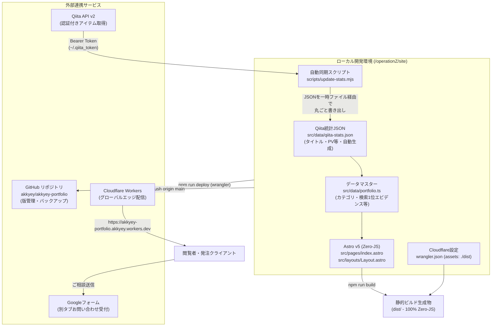

# @akkyey 公式ポートフォリオ＆ハブサイト 構築・運用完全手順書

本ドキュメントは、フリーランス活動・受託案件獲得の基盤として構築した独自ページ（Astro × Cloudflare Workers Static Assets）の設計思想、構築手順、自動化パイプライン、および今後の運用手順を体系的に記録したものです。

---

## 1. システム全体構成・アーキテクチャ



### 技術スタック
- **フレームワーク**: Astro v5（静的ビルド・Google Fonts以外の外部スクリプト読み込みを排除したZero-JS設計）
- **言語・型付け**: TypeScript / Node.js
- **インフラ・ホスティング**: Cloudflare Workers with Static Assets（`wrangler.json` 構成）
- **デプロイ・版管理**: `npm run deploy` による直接エッジ配信 ＋ GitHubリポジトリ（`akkyey/akkyey-portfolio`）へのバックアップ
- **データ更新パイプライン**: Qiita API v2（ページネーション対応・全体公開記事限定）＋ 自作同期スクリプト（`scripts/update-stats.mjs`）→ `src/data/qiita-stats.json`
- **お問い合わせ窓口**: Google フォーム（別タブ遷移型・ログイン不要・Gmail即時通知）
- **アクセス制御**: `noindex, nofollow` メタタグ ＋ `robots.txt`（Twitterbotのみカードプレビュー許可、他クローラーは遮断）

---

## 2. ディレクトリ構成

```text
operationZ/
├── HANDOFF_COMMON.md           # 共通コンテキスト・実績データ（全31記事・検索上位状況）
├── HANDOFF_PAGE.md             # 独自ページ設計方針・構成引き継ぎ書
├── HANDOFF_SEO.md              # SEO・内部リンク強化引き継ぎ書
├── PORTFOLIO_SETUP_GUIDE.md    # 本手順書
├── qiita_articles/             # Qiita記事Markdown原本・ドラフト保管場所
└── site/                       # Astroプロジェクトルート
    ├── .gitignore              # Git除外設定（dist, node_modules, *.backup-*）
    ├── astro.config.mjs        # Astro設定（静的ビルド、HTML圧縮）
    ├── package.json            # npmスクリプト・依存関係定義
    ├── tsconfig.json           # TypeScript厳格設定
    ├── wrangler.json           # Cloudflare Workers 静的配信定義
    ├── gas-webhook/
    │   └── Code.gs             # （参考用）スプレッドシート連携用GASコード
    ├── public/
    │   ├── akkyey-avatar-96.webp   # ヘッダー・プロフィール表示用アバター
    │   ├── akkyey-portrait-480.webp
    │   ├── akkyey-portrait-960.webp
    │   ├── favicon.svg             # 六角形にアルファベットAを配置したSVGファビコン
    │   ├── og-image.png            # OGP画像（1200x630）
    │   └── robots.txt              # クローラー制御設定（Twitterbot許可、他Disallow: /）
    ├── scripts/
    │   └── update-stats.mjs        # Qiita API v2 から qiita-stats.json を生成
    └── src/
        ├── content.config.ts   # Astro v5 Content Layer設定
        ├── content/
        │   └── notes/          # 技術ノート・検証メモMarkdown（*.md）
        ├── data/
        │   ├── portfolio.ts    # 記事のカテゴリ等・検索1位エビデンス・プラン定義（手で編集）
        │   └── qiita-stats.json # Qiita公開記事のタイトル・PV等（update-statsが自動生成・手で編集しない）
        ├── layouts/
        │   └── Layout.astro    # 共通レイアウト・SEO・JSON-LD構造化データ
        └── pages/
            ├── index.astro     # メインページ（全セクション構成・Zero-JS）
            └── notes/
                ├── index.astro # 技術ノート一覧ページ
                └── [...slug].astro # 技術ノート個別記事ページ
```

---

## 3. 実装詳細と主要コンポーネント

### 3.1. データマスター (`src/data/portfolio.ts`)
データは2つのファイルに分けています。

- **`qiita-stats.json`（自動生成）**: Qiita の公開記事のタイトル・URL・PV・いいね・ストック・タグ・日付。`npm run update-stats` が丸ごと書き出すので、手で編集しません。
- **`portfolio.ts`（手で編集）**: 記事ごとの独自情報 `ARTICLE_META`（カテゴリ・検索上位バッジ・注目フラグ）、11領域の実測Google検索1位クエリ、サービスメニュー（対象・期間目安）、Zenn Book企画。

`ALL_ARTICLES` はビルド時に JSON と `ARTICLE_META` を記事IDで合体して作り、`SITE_STATS` の合計値も一覧から計算します。そのため「総数と一覧の件数」「合計と個別の和」は構造上ずれません。

### 3.2. ゼロJSアーキテクチャ (`src/pages/index.astro`)
- **クライアントJSを完全排除**:
  - ヒーローセクション、3つの専門領域、検索1位エビデンス表、書籍・OSS一覧、全31記事アーカイブ、サービスプランまでをピュアHTML/CSSでレンダリング。
  - お問い合わせフォームをGoogleフォーム別タブ型に集約したことで、バリデーションスクリプト等のクライアントJSも完全不要化（0バイト）。
  - Google Fonts以外の外部スクリプト読み込みが一切ないため、エッジ配信と合わせて高速な初期表示が実現されています。

### 3.3. Googleフォーム連携
- **URL**: `https://docs.google.com/forms/d/e/1FAIpQLScNXZCqWAvDhvRGUUxNFqIOgAePvuUZ9DCsIjOkxFcn6ia6IA/viewform`
- **設定ポイント**:
  - 「回答を1回に制限（ログイン必須）」をOFFにして、Googleアカウントを持たない訪問者も回答可能に設定。
  - 「新しい回答についてのメール通知を受け取る」をONにして、Gmailに即時通知されるように構成。

### 3.4. Qiita統計自動同期パイプライン (`scripts/update-stats.mjs`)
- ローカルの認証トークン（`~/.qiita_token`）を読み込み、Qiita API v2 から認証ヘッダー付きで全件取得（100件以上のページネーション対応）。
- `!item.private` フィルタにより限定共有記事を除外し、公開記事のみを対象にする（下書きは API から返らない）。
- 結果を `src/data/qiita-stats.json` に丸ごと書き出す（一時ファイルに書いてから `renameSync` で置き換え）。TypeScript のソースは書き換えない。
- 基準日 `asOfDate` は日本時間（JST）の `YYYY-MM-DD`。
- API エラー時は何も書き込まずに終了する。
- 前回から増えた記事・消えた記事を表示する。**新しい記事が出たら `portfolio.ts` の `ARTICLE_META` にカテゴリを1行追加**する（未登録でもビルドは通り、警告が出る）。

---

## 4. Cloudflare デプロイ構成

### 4.1. Workers Static Assets の採用
2024年以降のCloudflare最新仕様である **Workers with Static Assets** を採用しています。
ルートディレクトリに以下の `wrangler.json` を配置することで、Workerコードを書くことなく静的ファイル配信を行っています。

```json
{
  "$schema": "node_modules/wrangler/config-schema.json",
  "name": "akkyey-portfolio",
  "compatibility_date": "2024-09-23",
  "assets": {
    "directory": "./dist"
  }
}
```

### 4.2. 限定公開（ステージング防御）設定
一般公開前のプレビュー期間中に検索エンジンへインデックスされるのを防ぐため、以下の制御を行っています：
1. `src/layouts/Layout.astro` に `<meta name="robots" content="noindex, nofollow" />` を配置。
2. `public/robots.txt` にて `User-agent: *` に対する `Disallow: /` を設定。
3. **X（Twitter）カード用の例外設定**:  
   Twitterbotは `robots.txt` の `Disallow: /` を厳格に遵守するため、`User-agent: Twitterbot` のみ `Allow: /` を明示してサムネイルカードが表示されるように設定しています。
   > **⚠️ 注意**: 限定公開中は、Twitterbot以外のクローラー（Facebook、Slack、LINE、Discord等）ではリンクプレビューのカード展開が行われない場合があります。

---

## 5. 日常の運用手順マニュアル

### 5.1. 統計数値（PV・いいね・ストック）を最新に更新する
ターミナルで以下のコマンドを実行するだけです：

```bash
cd /Users/irom/Documents/operationZ/site
npm run update-stats
npm run deploy
git add src/data/qiita-stats.json src/data/portfolio.ts
git commit -m "chore: sync latest qiita stats"
git push origin main
```
→ 統計更新後、`npm run deploy` で本番へ即時反映され、`git push` で最新データがGitHubにバックアップされます。

### 5.2. サイトの文言修正または技術ノートの追加・編集
ポートフォリオ本体の修正も、技術ノート（`/notes`）の追加も、**完全に同一のワンコマンド運用**です。

#### コマンドを実行する場所（作業ディレクトリ）
コマンドは必ず **`site` フォルダ**（`/Users/irom/Documents/operationZ/site`）の中で実行します。

```bash
# 1. サイトの作業フォルダへ移動（ターミナル起動時）
cd /Users/irom/Documents/operationZ/site

# 2. ビルド＆本番デプロイを一発実行
npm run deploy

# 3. 変更をGitHubへバックアップ保存
git add .
git commit -m "feat: 記事追加または文言修正"
git push origin main
```

> **💡 最も簡単な方法（AIチャットへの指示出し）**  
> ターミナルを開いてコマンドを打たなくても、AI（Antigravity）に「この記事をノートに追加して本番デプロイして」「トップページのここを変えて反映して」と一言チャットで伝えるだけで、ファイル作成からビルド・Cloudflare公開・Git保存まで全自動で代行されます。

### 5.3. 正式オープン（検索エンジンへの一般公開）に切り替える時
準備が整い、Google検索からの流入を受け入れたい時は以下の2箇所を変更します：
1. `src/layouts/Layout.astro` の `<meta name="robots" content="noindex, nofollow" />` を削除（または `index, follow` に変更）。
2. `public/robots.txt` の `Disallow: /` を削除（`Allow: /` に統一）。
3. デプロイおよびコミット・プッシュを実行：
   ```bash
   npm run deploy
   git add .
   git commit -m "feat: release site publicly"
   git push origin main
   ```
   これで世界中の検索エンジンへのインデックスが開始され、SlackやFacebookなど全プラットフォームでのリンクプレビューも有効になります。

---

## 6. リポジトリ・本番URL情報一覧

- **本番サイトURL**: [https://akkyey-portfolio.akkyey.workers.dev/](https://akkyey-portfolio.akkyey.workers.dev/)
- **GitHubリポジトリ**: [https://github.com/akkyey/akkyey-portfolio](https://github.com/akkyey/akkyey-portfolio)
- **お問い合わせGoogleフォーム**: [https://docs.google.com/forms/d/e/1FAIpQLScNXZCqWAvDhvRGUUxNFqIOgAePvuUZ9DCsIjOkxFcn6ia6IA/viewform](https://docs.google.com/forms/d/e/1FAIpQLScNXZCqWAvDhvRGUUxNFqIOgAePvuUZ9DCsIjOkxFcn6ia6IA/viewform)
- **Qiita公式プロフィール**: [https://qiita.com/akkyey](https://qiita.com/akkyey)
