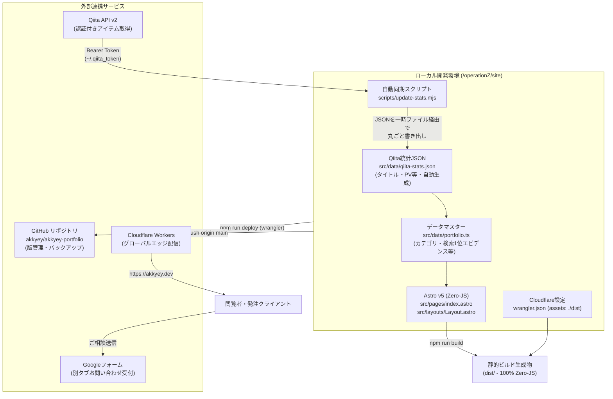

# @akkyey 公式ポートフォリオ＆ハブサイト 構築・運用完全手順書

本ドキュメントは、フリーランス活動・受託案件獲得の基盤として構築した独自ページ（Astro × Cloudflare Workers Static Assets）の設計思想、構築手順、自動化パイプライン、および今後の運用手順を体系的に記録したものです。

---

## 1. システム全体構成・アーキテクチャ



### 技術スタック
- **フレームワーク**: Astro v5（静的ビルド・Google Fonts以外の外部スクリプト読み込みを排除したZero-JS設計）
- **言語・型付け**: TypeScript / Node.js
- **インフラ・ホスティング**: Cloudflare Workers with Static Assets（`wrangler.json` 構成）
- **デプロイ・版管理**: `npm run deploy` による直接エッジ配信 ＋ GitHubリポジトリ（`akkyey/akkyey-portfolio`）へのバックアップ
- **データ更新パイプライン**: Qiita API v2（ページネーション対応・全体公開記事限定）＋ 自作同期スクリプト（`scripts/update-stats.mjs`）→ `src/data/qiita-stats.json`
- **お問い合わせ窓口**: Google フォーム（別タブ遷移型・ログイン不要・Gmail即時通知）
- **検索エンジン対応**: 一般公開（`robots.txt` で全許可）＋ 自作サイトマップ `/sitemap.xml` ＋ 全ページに正規 URL（`canonical`）。Qiita と同テーマのノートは Qiita 記事を正規 URL に指定

---

## 2. ディレクトリ構成

```text
operationZ/
├── HANDOFF_COMMON.md           # 共通コンテキスト・実績データ（全31記事・検索上位状況）
├── HANDOFF_PAGE.md             # 独自ページ設計方針・構成引き継ぎ書
├── HANDOFF_SEO.md              # SEO・内部リンク強化引き継ぎ書
├── PORTFOLIO_SETUP_GUIDE.md    # 本手順書
├── qiita_articles/             # Qiita記事Markdown原本・ドラフト保管場所
└── site/                       # Astroプロジェクトルート
    ├── .gitignore              # Git除外設定（dist, node_modules, *.backup-*）
    ├── astro.config.mjs        # Astro設定（静的ビルド、HTML圧縮）
    ├── package.json            # npmスクリプト・依存関係定義
    ├── tsconfig.json           # TypeScript厳格設定
    ├── wrangler.json           # Cloudflare Workers 静的配信定義
    ├── gas-webhook/
    │   └── Code.gs             # （参考用）スプレッドシート連携用GASコード
    ├── public/
    │   ├── akkyey-avatar-96.webp   # ヘッダー・プロフィール表示用アバター
    │   ├── akkyey-portrait-480.webp
    │   ├── akkyey-portrait-960.webp
    │   ├── favicon.svg             # 六角形にアルファベットAを配置したSVGファビコン
    │   ├── og-image.png            # OGP画像（1200x630）
    │   └── robots.txt              # 全クローラー許可＋サイトマップの場所
    ├── scripts/
    │   └── update-stats.mjs        # Qiita API v2 から qiita-stats.json を生成
    └── src/
        ├── content.config.ts   # Astro v5 Content Layer設定
        ├── content/
        │   └── notes/          # 技術ノート・検証メモMarkdown（*.md）。Qiita と同テーマなら frontmatter に qiitaUrl を書く
        ├── data/
        │   ├── portfolio.ts    # 記事のカテゴリ等・検索1位エビデンス・プラン定義（手で編集）
        │   └── qiita-stats.json # Qiita公開記事のタイトル・PV等（update-statsが自動生成・手で編集しない）
        ├── layouts/
        │   └── Layout.astro    # 共通レイアウト・SEO・JSON-LD構造化データ
        └── pages/
            ├── index.astro     # メインページ（全セクション構成・Zero-JS）
            └── notes/
                ├── index.astro # 技術ノート一覧ページ
                └── [...slug].astro # 技術ノート個別記事ページ（qiitaUrl があれば canonical と Qiita 案内リンクを出力）
            └── sitemap.xml.ts  # サイトマップ生成（下書きと qiitaUrl 付きノートは除外）
```

---

## 3. 実装詳細と主要コンポーネント

### 3.1. データマスター (`src/data/portfolio.ts`)
データは2つのファイルに分けています。

- **`qiita-stats.json`（自動生成）**: Qiita の公開記事のタイトル・URL・PV・いいね・ストック・タグ・日付。`npm run update-stats` が丸ごと書き出すので、手で編集しません。
- **`portfolio.ts`（手で編集）**: 記事ごとの独自情報 `ARTICLE_META`（カテゴリ・検索上位バッジ・注目フラグ）、11領域の実測Google検索1位クエリ、サービスメニュー（対象・期間目安）、Zenn Book企画。

`ALL_ARTICLES` はビルド時に JSON と `ARTICLE_META` を記事IDで合体して作り、`SITE_STATS` の合計値も一覧から計算します。そのため「総数と一覧の件数」「合計と個別の和」は構造上ずれません。

### 3.2. ゼロJSアーキテクチャ (`src/pages/index.astro`)
- **クライアントJSを完全排除**:
  - ヒーローセクション、3つの専門領域、検索1位エビデンス表、書籍・OSS一覧、全31記事アーカイブ、サービスプランまでをピュアHTML/CSSでレンダリング。
  - お問い合わせフォームをGoogleフォーム別タブ型に集約したことで、バリデーションスクリプト等のクライアントJSも完全不要化（0バイト）。
  - Google Fonts以外の外部スクリプト読み込みが一切ないため、エッジ配信と合わせて高速な初期表示が実現されています。

### 3.3. Googleフォーム連携
- **URL**: `https://docs.google.com/forms/d/e/1FAIpQLScNXZCqWAvDhvRGUUxNFqIOgAePvuUZ9DCsIjOkxFcn6ia6IA/viewform`
- **設定ポイント**:
  - 「回答を1回に制限（ログイン必須）」をOFFにして、Googleアカウントを持たない訪問者も回答可能に設定。
  - 「新しい回答についてのメール通知を受け取る」をONにして、Gmailに即時通知されるように構成。

### 3.4. Qiita統計自動同期パイプライン (`scripts/update-stats.mjs`)
- ローカルの認証トークン（`~/.qiita_token`）を読み込み、Qiita API v2 から認証ヘッダー付きで全件取得（100件以上のページネーション対応）。
- `!item.private` フィルタにより限定共有記事を除外し、公開記事のみを対象にする（下書きは API から返らない）。
- 結果を `src/data/qiita-stats.json` に丸ごと書き出す（一時ファイルに書いてから `renameSync` で置き換え）。TypeScript のソースは書き換えない。
- 基準日 `asOfDate` は日本時間（JST）の `YYYY-MM-DD`。
- API エラー時は何も書き込まずに終了する。
- 前回から増えた記事・消えた記事を表示する。**新しい記事が出たら `portfolio.ts` の `ARTICLE_META` にカテゴリを1行追加**する（未登録でもビルドは通り、警告が出る）。

---

## 4. Cloudflare デプロイ構成

### 4.1. Workers Static Assets の採用
2024年以降のCloudflare最新仕様である **Workers with Static Assets** を採用しています。
ルートディレクトリに以下の `wrangler.json` を配置することで、Workerコードを書くことなく静的ファイル配信を行っています。

```json
{
  "$schema": "node_modules/wrangler/config-schema.json",
  "name": "akkyey-portfolio",
  "compatibility_date": "2024-09-23",
  "assets": {
    "directory": "./dist"
  },
  "routes": [
    { "pattern": "akkyey.dev", "custom_domain": true }
  ]
}
```

`routes` の `custom_domain: true` により、`npm run deploy` 時に独自ドメイン `akkyey.dev`（Cloudflare Registrar で取得）が Worker に自動で紐付き、証明書も自動発行されます。ドメインを変える場合は、ここと `astro.config.mjs` の `site` の2か所を変更し、OGP 画像（`public/og-image.png`）内の URL 表記も作り直します。

### 4.2. 検索エンジン向けの設定（一般公開）
- `public/robots.txt`: 全クローラーを許可し、サイトマップの場所（`https://akkyey.dev/sitemap.xml`）を記載。
- `src/pages/sitemap.xml.ts`: ビルド時に `/sitemap.xml` を生成。下書き（`draft: true`）と、Qiita を正規 URL にしているノート（`qiitaUrl` あり）は含めない。外部パッケージは使っていない。
- `src/layouts/Layout.astro`: 全ページに `<link rel="canonical">` を出力。既定は `akkyey.dev` 上のそのページ自身。旧アドレス（workers.dev）で見られても、評価は `akkyey.dev` に集まる。
- **Google Search Console**: 2026-10-26 に `akkyey.dev` をドメインプロパティとして登録・所有権確認（Cloudflare DNS 連携）およびサイトマップ `https://akkyey.dev/sitemap.xml` の送信を完了（ステータス「成功しました」、検出ページ数「3」を確認済み）。
  - **更新不要の仕組み**: Google が `sitemap.xml` を定期的に自動巡回するため、記事やノートを追加した際も Search Console 側での再送信・手動更新作業は不要（サイト側で `npm run deploy` 時に自動更新される）。

### 4.3. メール（`contact@akkyey.dev`）
- Cloudflare Email Routing で `contact@akkyey.dev` 宛てのメールを Gmail に転送（無料・受信のみ）。MX / SPF / DKIM のレコードは Email Routing が自動で追加。
- Gmail 側で「To: contact@akkyey.dev → 迷惑メールにしない」のフィルタを設定（新しいドメインからの転送は最初、迷惑メールに入りやすいため）。
- 返信は Gmail アドレスから行う。独自ドメインで送信したくなったら Google Workspace に移行する（その際は MX レコードを Google 向けに付け替える）。

---

## 5. 日常の運用手順マニュアル

### 5.1. 統計数値（PV・いいね・ストック）を最新に更新する
ターミナルで以下のコマンドを実行するだけです：

```bash
cd /Users/irom/Documents/operationZ/site
npm run update-stats
npm run deploy
git add src/data/qiita-stats.json src/data/portfolio.ts
git commit -m "chore: sync latest qiita stats"
git push origin main
```
→ 統計更新後、`npm run deploy` で本番へ即時反映され、`git push` で最新データがGitHubにバックアップされます。

### 5.2. サイトの文言修正または技術ノートの追加・編集
ポートフォリオ本体の修正も、技術ノート（`/notes`）の追加も、**完全に同一のワンコマンド運用**です。

#### コマンドを実行する場所（作業ディレクトリ）
コマンドは必ず **`site` フォルダ**（`/Users/irom/Documents/operationZ/site`）の中で実行します。

```bash
# 1. サイトの作業フォルダへ移動（ターミナル起動時）
cd /Users/irom/Documents/operationZ/site

# 2. ビルド＆本番デプロイを一発実行
npm run deploy

# 3. 変更をGitHubへバックアップ保存
git add .
git commit -m "feat: 記事追加または文言修正"
git push origin main
```

> **💡 最も簡単な方法（AIチャットへの指示出し）**  
> ターミナルを開いてコマンドを打たなくても、AI（Antigravity）に「この記事をノートに追加して本番デプロイして」「トップページのここを変えて反映して」と一言チャットで伝えるだけで、ファイル作成からビルド・Cloudflare公開・Git保存まで全自動で代行されます。

### 5.3. お知らせ（`/news` とトップページの「お知らせ」欄）

お知らせは3種類を自動で混ぜて、新しい順に並べています（`src/data/news.ts`）。トップページには最新3件、`/news` には全件が出ます。

| 種類 | 元データ | 追加のしかた |
| :--- | :--- | :--- |
| Qiita | `src/data/qiita-stats.json` | `npm run update-stats` を実行すれば自動で増える |
| 技術ノート | `src/content/notes/*.md` | ノートを追加すれば自動で増える（`draft: true` は出ない） |
| お知らせ | `src/content/news/*.md` | 下の形式で1件1ファイルを手で追加する |

```markdown
---
title: "サイトのアドレスを akkyey.dev に移転しました"
date: 2026-10-26
link: "/"            # 任意。外部URLなら新しいタブで開く
---
```

本文は表示しないので、`title` / `date` / `link` だけ書けば十分です。追加したら `npm run deploy` で反映します。

### 5.4. 技術ノートを追加するときのルール（フロントマター仕様 ＆ 検索競合防止）

技術ノート（`src/content/notes/*.md`）を作成・追加する際は、以下のフロントマター（メタデータ）仕様と検索競合防止ルールに従います。

#### ① フロントマター（frontmatter）の記述仕様
Astro の Content Layer（`src/content.config.ts`）で厳格に型定義されています。**必須項目が欠けているとビルドエラー（`npm run deploy` 停止）になるためご注意ください**。

| 項目 | 必須/任意 | 型 | 説明・例 |
| :--- | :---: | :--- | :--- |
| `title` | **必須** | 文字列 | 記事のタイトル（例: `"Google Colabで..."`） |
| `description` | **必須** | 文字列 | 記事の概要・要約（ノート一覧ページに表示） |
| `pubDate` | **必須** | 日付 | 公開日（形式: `YYYY-MM-DD`、例: `2026-10-26`） |
| `updatedDate` | 任意 | 日付 | 最終更新日（追記・改修時のみ記載） |
| `tags` | 任意 | 配列 | タグ一覧（例: `["Python", "Colab", "Git"]`、未指定時は空配列） |
| `draft` | 任意 | 真偽値 | 下書き・非公開フラグ（`true` にすると `/sitemap.xml` から自動除外） |
| `qiitaUrl` | 任意 | URL | Qiita同テーマ記事のURL（**検索競合防止の最重要項目**） |

#### ② 検索で Qiita 記事と競合させない（最重要ルール）
Qiita と同じテーマのページが2つあると、Google はどちらか一方だけを検索結果に出そうとします。今上位にいる Qiita 記事がノートに置き換わって順位を落とさないよう、**ノートを書いたら次を確認します**。

1. **Qiita に同じテーマの記事があるか確認する**
2. **あれば、ノートの frontmatter に `qiitaUrl` を書く**
   ```markdown
   ---
   title: "..."
   pubDate: 2026-10-18
   description: "..."
   tags: ["..."]
   qiitaUrl: "https://qiita.com/akkyey/items/xxxxxxxx"
   ---
   ```
   これだけで、次の3つが自動で行われます。
   - ページの `canonical` が Qiita 記事を指す（検索の評価は Qiita に集まり、ノートは基本的に検索結果に出なくなる）
   - 本文の末尾に「Qiita で読む」の案内リンクが付く
   - `/sitemap.xml` から外れる
3. **Qiita にない、ノートだけの内容なら何も書かない**（`akkyey.dev` のページとして検索に出る）

迷ったら付けておく、で問題ありません。書き忘れてもサイトは壊れず、検索で競合する可能性が残るだけです。

> **💡 なぜ本文中のリンクだけではダメなのか？**  
> 本文中に Qiita 記事へのリンクを張るだけでは、Google にとっては「関連ページへのリンク」に過ぎず、重複コンテンツとしての競合は避けられません。検索エンジンに正規ページを明示するため、必ず `qiitaUrl`（`<link rel="canonical">`）とセットで使います。

---

## 6. リポジトリ・本番URL情報一覧

- **本番サイトURL**: [https://akkyey.dev/](https://akkyey.dev/)（旧: https://akkyey-portfolio.akkyey.workers.dev/）
- **GitHubリポジトリ**: [https://github.com/akkyey/akkyey-portfolio](https://github.com/akkyey/akkyey-portfolio)
- **お問い合わせGoogleフォーム**: [https://docs.google.com/forms/d/e/1FAIpQLScNXZCqWAvDhvRGUUxNFqIOgAePvuUZ9DCsIjOkxFcn6ia6IA/viewform](https://docs.google.com/forms/d/e/1FAIpQLScNXZCqWAvDhvRGUUxNFqIOgAePvuUZ9DCsIjOkxFcn6ia6IA/viewform)
- **Qiita公式プロフィール**: [https://qiita.com/akkyey](https://qiita.com/akkyey)
