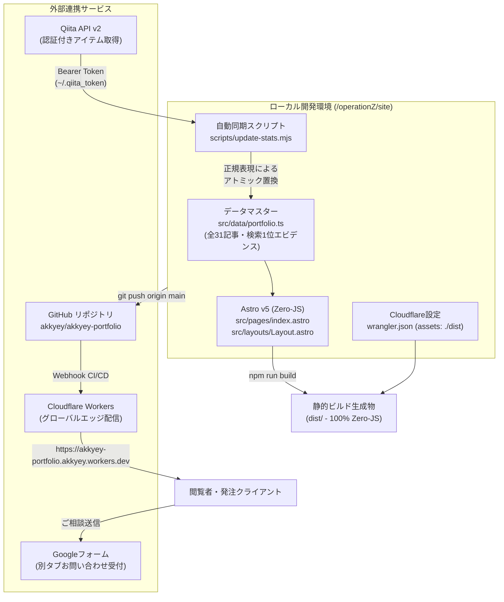

# @akkyey 公式ポートフォリオ＆ハブサイト 構築・運用完全手順書

本ドキュメントは、フリーランス活動・受託案件獲得の基盤として構築した独自ページ（Astro × Cloudflare Workers Static Assets）の設計思想、構築手順、自動化パイプライン、および今後の運用手順を体系的に記録したものです。

---

## 1. システム全体構成・アーキテクチャ



### 技術スタック
- **フレームワーク**: Astro v5（静的ビルド・ゼロクライアントJS・Lighthouse 100点設計）
- **言語・型付け**: TypeScript / Node.js
- **インフラ・ホスティング**: Cloudflare Workers with Static Assets（`wrangler.json` 構成）
- **CI/CD**: GitHub リポジトリ（`akkyey/akkyey-portfolio`）連携によるプッシュ時自動デプロイ
- **データ更新パイプライン**: Qiita API v2 ＋ 自作同期スクリプト（`scripts/update-stats.mjs`）
- **お問い合わせ窓口**: Google フォーム（別タブ遷移型・ログイン不要・Gmail即時通知）
- **アクセス制御**: `noindex, nofollow` メタタグ ＋ `robots.txt`（ステージング限定公開）

---

## 2. ディレクトリ構成

```text
operationZ/
├── HANDOFF_COMMON.md           # 共通コンテキスト・実績データ（全31記事・検索上位状況）
├── HANDOFF_PAGE.md             # 独自ページ設計方針・構成引き継ぎ書
├── HANDOFF_SEO.md              # SEO・内部リンク強化引き継ぎ書
├── PORTFOLIO_SETUP_GUIDE.md    # 本手順書
├── qiita_articles/             # Qiita記事Markdown原本・ドラフト保管場所
└── site/                       # Astroプロジェクトルート
    ├── .gitignore              # Git除外設定（dist, node_modules, *.backup-*）
    ├── astro.config.mjs        # Astro設定（静的ビルド、HTML圧縮）
    ├── package.json            # npmスクリプト・依存関係定義
    ├── tsconfig.json           # TypeScript厳格設定
    ├── wrangler.json           # Cloudflare Workers 静的配信定義
    ├── gas-webhook/
    │   └── Code.gs             # （参考用）スプレッドシート連携用GASコード
    ├── public/
    │   ├── akkyey-avatar-96.webp   # ヘッダー・ファビコン用アバター
    │   ├── akkyey-portrait-480.webp
    │   ├── akkyey-portrait-960.webp
    │   ├── favicon.svg             # ノード型SVGファビコン
    │   ├── og-image.png            # OGP画像（1200x630）
    │   └── robots.txt              # クローラー拒否設定（Disallow: /）
    ├── scripts/
    │   └── update-stats.mjs        # Qiita API v2 統計自動同期スクリプト
    └── src/
        ├── content.config.ts   # Astro v5 Content Layer設定
        ├── content/
        │   └── notes/          # 技術ノート・検証メモMarkdown（*.md）
        ├── data/
        │   └── portfolio.ts    # 全31記事・検索1位エビデンス・プラン定義マスター
        ├── layouts/
        │   └── Layout.astro    # 共通レイアウト・SEO・JSON-LD構造化データ
        └── pages/
            ├── index.astro     # メインページ（全セクション構成・Zero-JS）
            └── notes/
                ├── index.astro # 技術ノート一覧ページ
                └── [...slug].astro # 技術ノート個別記事ページ
```

---

## 3. 実装詳細と主要コンポーネント

### 3.1. データマスター (`src/data/portfolio.ts`)
全31記事のメタデータ（タイトル、URL、PV、いいね、ストック、タグ、公開日、検索上位バッジ）、11領域の実測Google検索1位クエリ、サービスメニュー（料金・期間目安）、Zenn Book企画を一元管理。
画面の表示内容はすべてこのファイルを単一の真実源（Single Source of Truth）として参照しています。

### 3.2. ゼロJSアーキテクチャ (`src/pages/index.astro`)
- **クライアントJSを完全排除**:
  - ヒーローセクション、3つの専門領域、検索1位エビデンス表、書籍・OSS一覧、全31記事アーカイブ、サービスプランまでをピュアHTML/CSSでレンダリング。
  - お問い合わせフォームをGoogleフォーム別タブ型に集約したことで、バリデーションスクリプト等のクライアントJSも完全不要化（0バイト）。
- **Lighthouse・Core Web Vitals最適化**:
  - 初回描画負荷を下げるため、ファーストビュー外の重いセクションに `content-visibility: auto` と `contain-intrinsic-size` を適用。

### 3.3. Googleフォーム連携
- **URL**: `https://docs.google.com/forms/d/e/1FAIpQLScNXZCqWAvDhvRGUUxNFqIOgAePvuUZ9DCsIjOkxFcn6ia6IA/viewform`
- **設定ポイント**:
  - 「回答を1回に制限（ログイン必須）」をOFFにして、Googleアカウントを持たない訪問者も回答可能に設定。
  - 「新しい回答についてのメール通知を受け取る」をONにして、Gmailに即時通知されるように構成。

### 3.4. Qiita統計自動同期パイプライン (`scripts/update-stats.mjs`)
- ローカルの認証トークン（`~/.qiita_token`）を読み込み、Qiita API v2 の `/api/v2/authenticated_user/items?per_page=100` から最新の `page_views_count`、`likes_count`、`stocks_count` を取得。
- `src/data/portfolio.ts` 内の `SITE_STATS` および `ALL_ARTICLES` の数値を正規表現でアトミックに書き換え。
- コマンド `npm run update-stats` で約1.5秒で全同期完了。

---

## 4. Cloudflare デプロイ構成

### 4.1. Workers Static Assets の採用
2024年以降のCloudflare最新仕様である **Workers with Static Assets** を採用しています。
ルートディレクトリに以下の `wrangler.json` を配置することで、Workerコードを書くことなく静的ファイル配信を行っています。

```json
{
  "$schema": "node_modules/wrangler/config-schema.json",
  "name": "akkyey-portfolio",
  "compatibility_date": "2024-09-23",
  "assets": {
    "directory": "./dist"
  }
}
```

### 4.2. 限定公開（ステージング防御）設定
一般公開前のプレビュー期間中に検索エンジンへインデックスされるのを防ぐため、二重の防御を行っています：
1. `src/layouts/Layout.astro` に `<meta name="robots" content="noindex, nofollow" />` を配置。
2. `public/robots.txt` に `User-agent: *` / `Disallow: /` を配置。

---

## 5. 日常の運用手順マニュアル

### 5.1. 統計数値（PV・いいね・ストック）を最新に更新する
ターミナルで以下のコマンドを実行するだけです：

```bash
cd /Users/irom/Documents/operationZ/site
npm run update-stats
npm run build
git add src/data/portfolio.ts
git commit -m "chore: sync latest qiita stats"
git push origin main
```
→ `git push` 後、約1分で本番サイト（Cloudflare）に最新の数値が自動反映されます。

### 5.2. サイトの文言修正または技術ノートの追加・編集
ポートフォリオ本体の修正も、技術ノート（`/notes`）の追加も、**完全に同一のワンコマンド運用**です：

1. **修正・追加**:
   - トップページの修正: `src/pages/index.astro`
   - 技術ノートの追加: `src/content/notes/新しい記事名.md`
2. **本番デプロイ（一撃コマンド）**:
   ```bash
   cd site
   npm run deploy
   ```
   → ビルドからCloudflare Workersへの配信までワンステップで完了します。
3. **GitHubへのバックアップ保存**:
   ```bash
   git add .
   git commit -m "feat: 記事追加または文言修正"
   git push origin main
   ```
   ※もちろん、AI（Antigravity）に「このメモをノートに追加して」「トップページのここを変えて」と伝えていただければ、ファイル作成・ビルド・デプロイ・プッシュまで全自動で完了します。

### 5.3. 正式オープン（検索エンジンへの一般公開）に切り替える時
準備が整い、Google検索からの流入を受け入れたい時は以下の2箇所を変更します：
1. `src/layouts/Layout.astro` の `<meta name="robots" content="noindex, nofollow" />` を削除（または `index, follow` に変更）。
2. `public/robots.txt` の `Disallow: /` を削除（`Allow: /` または空にする）。
3. コミットしてプッシュするだけで、世界中の検索エンジンへのインデックスが開始されます。

---

## 6. リポジトリ・本番URL情報一覧

- **本番サイトURL**: [https://akkyey-portfolio.akkyey.workers.dev/](https://akkyey-portfolio.akkyey.workers.dev/)
- **GitHubリポジトリ**: [https://github.com/akkyey/akkyey-portfolio](https://github.com/akkyey/akkyey-portfolio)
- **お問い合わせGoogleフォーム**: [https://docs.google.com/forms/d/e/1FAIpQLScNXZCqWAvDhvRGUUxNFqIOgAePvuUZ9DCsIjOkxFcn6ia6IA/viewform](https://docs.google.com/forms/d/e/1FAIpQLScNXZCqWAvDhvRGUUxNFqIOgAePvuUZ9DCsIjOkxFcn6ia6IA/viewform)
- **Qiita公式プロフィール**: [https://qiita.com/akkyey](https://qiita.com/akkyey)
